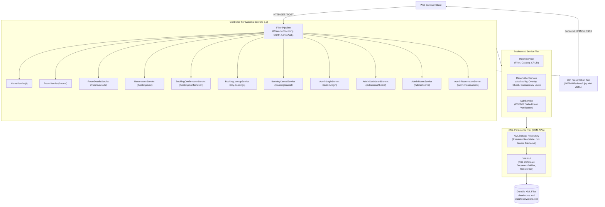

# Hotel Reservation System (KG Grand Hotel & Suites)

> **Full-Stack Java Web Application — College Project Submission & Academic Demonstration**  
> Built with Java Servlets, JSP (Jakarta EE 10), XML DOM Persistence, and Apache Tomcat 10.1.

---

## 1. Project Overview & Problem Statement

### Problem Statement
Traditional hospitality businesses and manual booking workflows suffer from fragmented reservation ledgers, double-booking risks, lack of real-time inventory visibility, and high software licensing overheads. In educational and standalone deployment contexts, relational database dependencies (such as MySQL or PostgreSQL) introduce deployment friction, server configuration requirements, and database credential security hurdles.

### Project Description & Objective
The **KG Grand Hotel Reservation System** is a full-stack, production-grade Java web application engineered without external relational database engines or heavy frameworks. It utilizes **pure Java DOM XML APIs** as a durable, zero-dependency persistent data store, while adhering strictly to the **Model-View-Controller (MVC)** architectural pattern. 

The system enables guests to explore curated luxury accommodations, evaluate amenities, check real-time date availability, book rooms with atomic concurrency guarantees, retrieve reservations securely, and manage cancellations. For hotel staff, an administrative portal offers metrics, room catalog maintenance, inventory status toggling, and reservation oversight.

---

## 2. Mandatory Technologies & Architectural Constraints

| Layer / Component | Technology Specification | Note / Compliance |
| :--- | :--- | :--- |
| **Language & Platform** | Java 17 (OpenJDK 17.0.18 LTS) | Strictly standard Java APIs |
| **Server-Side Controller** | Java Servlets 6.0 (`jakarta.servlet.*`) | Jakarta EE 10 / Tomcat 10.1 compatible |
| **Presentation Tier** | JSP 3.1 &amp; JSTL 3.0 (`jakarta.tags.core`) | Dynamic server-side rendering, zero static HTML mocks |
| **Persistence Tier** | Built-in Java DOM XML APIs (`javax.xml.*`) | Durable XML files (`rooms.xml`, `reservations.xml`), atomic replace |
| **Security & Hashing** | PBKDF2 with HmacSHA256, SecureRandom, CSRF | Zero third-party security framework overhead |
| **Web Application Server**| Apache Tomcat 10.1 (Embedded + Standalone WAR)| Deployable WAR generated in `target/` |
| **Styling & Interaction** | Vanilla CSS3 (Luxury hospitality aesthetic) &amp; Vanilla JS | Zero CSS/JS frameworks (no Bootstrap, Tailwind, or React) |
| **Build & Dependencies** | Apache Maven 3.9+ | Standard Maven layout and WAR packaging |

---

## 3. Core Features

### Guest Experience & Public Portal
1. **Curated Luxury Landing Page (`/`):** Hero showcase, headline, amenities grid, customer testimonials, and direct availability search bar.
2. **Room Catalog & Filter Engine (`/rooms`):** 
   - Filter by category (`Standard`, `Deluxe`, `Superior`, `Executive Suite`, `Family Suite`, `Presidential Suite`).
   - Price range filtering (e.g. Under ₹2,000 to ₹10,000+).
   - Capacity filtering (1 to 6+ guests).
   - Multi-field keyword search across room names, descriptions, and amenities.
   - Sorting by price (ascending/descending), capacity, or name.
   - Date range availability filtering.
3. **Room Specifications & Date Checker (`/rooms/details`):** High-resolution photography, amenity tags, room status indicator, and dynamic date availability check widget.
4. **Reservation Workflow (`/booking/new`):**
   - Live client-side price preview calculated dynamically upon date selection.
   - Server-side validation of customer name, RFC-compliant email, phone (10-15 digits), positive guest counts, and room capacity limits.
   - Date collision detection implementing the strict overlap condition:  
     $$\text{newCheckIn} < \text{existingCheckOut} \quad \text{AND} \quad \text{newCheckOut} > \text{existingCheckIn}$$
   - Exclusive check-out dates enabling back-to-back guest stays.
   - Atomic synchronized booking section preventing double-booking during concurrent user requests.
   - **Post/Redirect/Get (PRG)** design preventing duplicate form submissions on browser refresh.
5. **Printable Confirmation Receipt (`/booking/confirmation`):** Unique booking ID generation (`BK100001`), itemized stay duration, INR currency formatting, and print-optimized voucher layout.
6. **My Bookings Retrieval & Cancellation (`/my-bookings`):**
   - Dual-factor guest retrieval (Booking Reference + Registered Email) protecting privacy.
   - In-flight cancellation of eligible confirmed bookings with confirmation modal.
   - Instant XML status transition to `CANCELLED` and automated room inventory release.

### Administrative Management Portal
1. **Demonstration Authentication (`/admin/login`):** PBKDF2 cryptographic password verification with random salt, session authentication, and CSRF protection.
2. **Executive Analytics Dashboard (`/admin/dashboard`):** Real-time aggregation of total rooms, active inventory, confirmed bookings, upcoming arrivals, and gross estimated revenue.
3. **Room Catalog Management (`/admin/rooms`):**
   - Add new room records with pricing, descriptions, images, and amenities.
   - Edit existing room specifications.
   - Toggle room availability (`active` true/false) instantly preventing new bookings for decommissioned units.
4. **Reservation Oversight (`/admin/reservations`):**
   - View, search, and filter all historical reservations by status and active date.
   - Administrative reservation cancellation with synchronized XML updates.
5. **Secure Sign-Out (`/admin/logout`):** Invalidation of HTTP session and redirection.

---

## 4. Application Architecture



---

## 5. Project Directory Structure

```
hotel-reservation-system/
├── pom.xml                               # Maven project definition and dependencies
├── run.sh                                # One-click compilation and execution script
├── README.md                             # Comprehensive project documentation
├── docs/
│   └── PROJECT_REPORT.md                 # Formal academic project report
├── data/                                 # Persistent XML data directory
│   ├── rooms.xml                         # Room catalog records
│   └── reservations.xml                  # Guest reservation ledger
├── src/
│   ├── main/
│   │   ├── java/com/hotel/
│   │   │   ├── TomcatLauncher.java       # Embedded Tomcat 10.1 standalone bootstrap
│   │   │   ├── config/
│   │   │   │   ├── AppConfig.java        # Path resolution & environment config
│   │   │   │   └── SecurityUtil.java     # PBKDF2 hashing, CSRF & regex validators
│   │   │   ├── model/
│   │   │   │   ├── Room.java             # Room entity with INR formatting
│   │   │   │   ├── RoomType.java         # Room categories enum
│   │   │   │   ├── Reservation.java      # Reservation entity & stay helpers
│   │   │   │   ├── ReservationStatus.java# CONFIRMED / CANCELLED enum
│   │   │   │   └── AdminUser.java        # Administrator user model
│   │   │   ├── storage/
│   │   │   │   ├── XMLUtil.java          # XXE-safe DOM builder & atomic file writer
│   │   │   │   └── XMLStorage.java       # Thread-safe XML repository engine
│   │   │   ├── service/
│   │   │   │   ├── RoomService.java      # Room search & catalog management
│   │   │   │   ├── ReservationService.java# Booking concurrency & collision detection
│   │   │   │   └── AuthService.java      # Admin authentication service
│   │   │   ├── filter/
│   │   │   │   ├── CharacterEncodingFilter.java # UTF-8 encoding filter
│   │   │   │   ├── CsrfFilter.java       # CSRF protection & token validator
│   │   │   │   └── AdminAuthFilter.java  # Session authorization filter (/admin/*)
│   │   │   └── servlet/
│   │   │       ├── HomeServlet.java
│   │   │       ├── RoomServlet.java
│   │   │       ├── RoomDetailsServlet.java
│   │   │       ├── ReservationServlet.java
│   │   │       ├── BookingConfirmationServlet.java
│   │   │       ├── BookingLookupServlet.java
│   │   │       ├── BookingCancelServlet.java
│   │   │       ├── AdminLoginServlet.java
│   │   │       ├── AdminLogoutServlet.java
│   │   │       ├── AdminDashboardServlet.java
│   │   │       ├── AdminRoomServlet.java
│   │   │       └── AdminReservationServlet.java
│   │   ├── resources/
│   │   │   └── default-data/             # Built-in seed templates
│   │   │       ├── rooms.xml
│   │   │       └── reservations.xml
│   │   └── webapp/
│   │       ├── WEB-INF/
│   │       │   ├── web.xml               # Servlet 6.0 deployment descriptor
│   │       │   └── views/
│   │       │       ├── common/
│   │       │       │   ├── header.jsp
│   │       │       │   ├── nav.jsp
│   │       │       │   ├── footer.jsp
│   │       │       │   └── alerts.jsp
│   │       │       ├── index.jsp         # Home landing page
│   │       │       ├── rooms.jsp         # Room catalog & search
│   │       │       ├── room-details.jsp  # Room specifications & availability
│   │       │       ├── reservation.jsp   # Booking form
│   │       │       ├── confirmation.jsp  # Printable confirmation voucher
│   │       │       ├── my-bookings.jsp   # Booking reference & email lookup
│   │       │       ├── booking-details.jsp # Retrieved booking management
│   │       │       ├── booking-cancelled.jsp # Cancellation confirmation
│   │       │       ├── admin-login.jsp   # Administrative sign in
│   │       │       ├── admin-dashboard.jsp # Analytics metrics & overview
│   │       │       ├── admin-rooms.jsp   # Room administration table
│   │       │       ├── admin-room-form.jsp # Room add / edit form
│   │       │       ├── admin-reservations.jsp # Reservation administration
│   │       │       ├── error-404.jsp     # Custom 404 handler
│   │       │       └── error-500.jsp     # Custom 500 handler
│   │       └── assets/
│   │           ├── css/
│   │           │   ├── style.css         # Luxury hospitality theme
│   │           │   └── admin.css         # Admin dashboard styles
│   │           └── js/
│   │               ├── main.js           # General interactivity & printing
│   │               └── validation.js     # Live price calculation & validation
│   └── test/java/com/hotel/
│       ├── security/SecurityUtilTest.java
│       ├── storage/XMLStorageTest.java
│       ├── service/RoomServiceTest.java
│       ├── service/ReservationServiceTest.java
│       ├── service/ConcurrencyBookingTest.java
│       └── service/AuthServiceTest.java
```

---

## 6. System Requirements & Setup

### Prerequisites
- **Java Development Kit (JDK):** Version 17 LTS or 21 LTS installed (`java -version`).
- **Apache Maven:** Version 3.8.0 or newer (`mvn -version`).
- **Web Browser:** Google Chrome, Mozilla Firefox, Safari, or Microsoft Edge.
- **Port Availability:** TCP Port `8080` (or configured via environment variable `PORT`).

---

## 7. How to Run the Application

### Option A: Instant Run with Embedded Tomcat 10.1 (Recommended)

1. Open your terminal in the workspace root directory:
   ```bash
   cd /path/to/hotel-reservation-system
   ```

2. Execute the startup script:
   ```bash
   ./run.sh
   ```
   *Or execute directly via Maven:*
   ```bash
   mvn compile exec:java -Dexec.mainClass="com.hotel.TomcatLauncher"
   ```

3. Open your browser and navigate to:
   - **Guest Portal:** [http://localhost:8080/](http://localhost:8080/)
   - **Admin Portal:** [http://localhost:8080/admin/login](http://localhost:8080/admin/login)

### Option B: Deploying to External Apache Tomcat 10.1 Server

1. Package the production WAR bundle:
   ```bash
   mvn clean package
   ```
2. Locate the generated archive:
   ```
   target/hotel-reservation-system.war
   ```
3. Copy the WAR file to your standalone Apache Tomcat 10.1 installation's `webapps/` folder:
   ```bash
   cp target/hotel-reservation-system.war /opt/tomcat/webapps/ROOT.war
   ```
4. Start Tomcat using `catalina.sh start` or `startup.sh`.
5. Access the application at [http://localhost:8080/](http://localhost:8080/).

---

## 8. Configuration & Demonstration Credentials

### Administrator Sign-In
- **Portal URL:** `http://localhost:8080/admin/login`
- **Default Username:** `admin`
- **Default Password:** `Admin@Hotel2026`

*To override credentials, set environment variables or JVM system properties:*
```bash
export HOTEL_ADMIN_USER="director"
export HOTEL_ADMIN_PASS="SecretKey2026!"
```

### XML Data Directory Configuration
By default, the application writes data to `./data` relative to the application launch root.  
To store data in a custom absolute directory:
```bash
export HOTEL_DATA_DIR="/var/hotel-data"
# Or pass JVM property: -Dhotel.data.dir=/var/hotel-data
```

---

## 9. XML Storage Schema Specifications

### `rooms.xml` Schema
```xml
<?xml version="1.0" encoding="UTF-8"?>
<rooms>
    <room>
        <id>R001</id>
        <name>Standard Room</name>
        <type>STANDARD</type>
        <description>A thoughtfully designed, peaceful retreat...</description>
        <pricePerNight>1500.00</pricePerNight>
        <capacity>2</capacity>
        <amenities>
            <amenity>Free Wi-Fi</amenity>
            <amenity>Air Conditioning</amenity>
        </amenities>
        <imageUrl>https://images.unsplash.com/photo-...</imageUrl>
        <active>true</active>
    </room>
</rooms>
```

### `reservations.xml` Schema
```xml
<?xml version="1.0" encoding="UTF-8"?>
<reservations>
    <reservation>
        <bookingId>BK100001</bookingId>
        <customerName>Vikram Malhotra</customerName>
        <email>vikram@example.com</email>
        <phone>+91 98765 43210</phone>
        <roomId>R002</roomId>
        <checkIn>2026-11-05</checkIn>
        <checkOut>2026-11-08</checkOut>
        <guests>2</guests>
        <pricePerNight>2500.00</pricePerNight>
        <totalPrice>7500.00</totalPrice>
        <specialRequests>Quiet room</specialRequests>
        <status>CONFIRMED</status>
        <createdAt>2026-11-01T15:22:51.346616</createdAt>
    </reservation>
</reservations>
```

---

## 10. Automated Testing Strategy & Execution

Run the complete automated test suite covering persistence, security, collisions, and concurrency:
```bash
mvn test
```

### Test Suite Summary
- **`SecurityUtilTest` (6 tests):** Verifies PBKDF2 hashing, random salt uniqueness, CSRF token generation, RFC email formatting, phone validation, HTML escaping, and path traversal defense.
- **`XMLStorageTest` (4 tests):** Validates default 6-room XML seeding, room record modification, sequential booking ID generation (`BK100001`, `BK100002`), and atomic document replacement.
- **`RoomServiceTest` (6 tests):** Validates category filtering, price filtering, guest capacity constraints, keyword matching, price sorting, and active status toggling.
- **`ReservationServiceTest` (9 tests):** Validates price calculations, past date rejection, invalid check-out rejection, capacity enforcement, date collision blocking, back-to-back booking allowance, lookup verification, and cancellation status updates.
- **`ConcurrencyBookingTest` (1 test):** Simulates 10 simultaneous threads attempting to book the identical room for identical dates; asserts that strictly 1 thread succeeds and 9 threads receive conflict rejections.
- **`AuthServiceTest` (4 tests):** Verifies administrator credential validation, invalid passwords rejection, invalid usernames rejection, and null safety.

---

## 11. Known Limitations & Future Enhancements

### Limitations (Academic Demonstration Context)
1. **Single-Instance XML Synchronization:** File modifications are synchronized via JVM in-memory locks (`ReentrantReadWriteLock`). Clustered multi-node server deployment would require distributed file locks or database transactions.
2. **Payment Processing:** Payment processing is simulated through confirmed guaranteed reservations; an actual gateway (Razorpay/Stripe) is omitted per college project requirements.
3. **Guest Authentication:** Guest bookings rely on booking ID plus matching email lookup rather than a mandatory user registration account system.

### Future Scope
- Integration with external payment gateways (Razorpay / UPI).
- Automated email and SMS dispatch using JavaMail API and Twilio.
- Multi-hotel property management system (PMS) support.
- Room inventory analytics with interactive charting.
