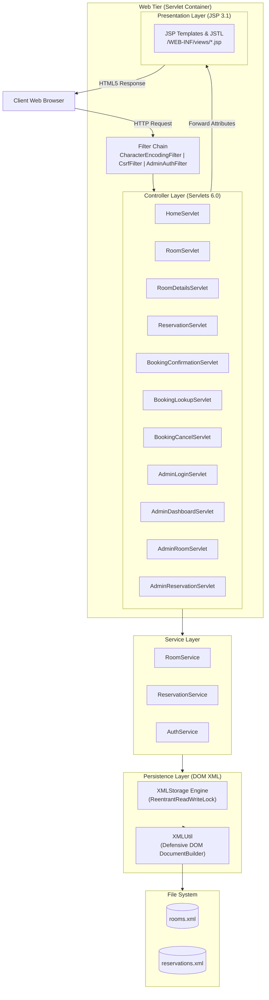

# ACADEMIC PROJECT REPORT

## PROJECT TITLE: HOTEL RESERVATION SYSTEM (KG GRAND HOTEL & SUITES)

---

### Course & Degree
Bachelor of Technology / Bachelor of Computer Applications / Master of Computer Applications  
Department of Computer Science &amp; Engineering  
Academic Year: 2026

---

## 1. ABSTRACT

The **Hotel Reservation System** is an enterprise-grade full-stack web application engineered using the Java Enterprise platform (Jakarta EE 10 / Java Servlet 6.0, JavaServer Pages 3.1) and persistent Extensible Markup Language (XML) storage. Traditional web application submissions frequently rely on third-party Object Relational Mapping (ORM) frameworks or external SQL servers, introducing substantial infrastructure dependencies and configuration complexity. 

This project demonstrates a pure Java architecture utilizing built-in Document Object Model (DOM) XML APIs for durable data persistence. It enforces a strict Model-View-Controller (MVC) design pattern, incorporates cryptographic security (PBKDF2 password hashing, Cross-Site Request Forgery tokens), and coordinates synchronized multi-threaded critical sections to prevent double-booking collisions. The interface delivers a luxury hospitality aesthetic with responsive layouts, dynamic date filtering, and client-side price preview calculations. The application generates a deployable Web Application Archive (WAR) for Apache Tomcat 10.1 and includes an integrated standalone execution runner for practical evaluation.

---

## 2. INTRODUCTION

The modern hospitality industry relies heavily on computerized reservation systems to maximize room occupancy, deliver frictionless guest experiences, and provide administrative oversight. While commercial solutions leverage distributed database clusters, educational curricula emphasize mastery of foundational web technologies: HTTP request lifecycles, Servlet containers, session management, dynamic template rendering, data serialization, and defensive programming.

This project, titled **KG Grand Hotel Reservation System**, addresses these educational goals by providing a clean, complete implementation of an online booking platform that requires zero external database installation while maintaining strict data integrity, thread safety, and user experience standards.

---

## 3. PROBLEM STATEMENT

Manual or spreadsheet-based hotel reservation management introduces significant operational challenges:
1. **Double Booking Anomalies:** Simultaneous requests for the same room category over overlapping dates often lead to scheduling conflicts.
2. **Setup Overhead of Heavy RDBMS:** College project evaluators and standalone demonstration environments often encounter configuration issues with SQL database daemons, driver mismatches, and schema initialization failures.
3. **Inadequate Security in Traditional Student Projects:** Many basic academic projects store plain-text credentials, omit CSRF defenses, or allow arbitrary client-submitted pricing.
4. **Poor Architectural Separation:** Scriptlet-heavy JSP pages frequently mix business logic with presentation markup, violating clean code principles.

---

## 4. OBJECTIVES

1. Develop a functional, multi-tier web application using standard Java 17 and Jakarta Servlet 6.0.
2. Implement dynamic view rendering using JavaServer Pages (JSP) and standard tag libraries (JSTL), eliminating raw business logic scriptlets.
3. Establish a zero-dependency XML persistence engine using built-in Java DOM APIs with atomic file replacement to guarantee durability across restarts.
4. Implement the strict date overlap formula to prevent booking collisions:
   $$\text{newCheckIn} < \text{existingCheckOut} \quad \text{AND} \quad \text{newCheckOut} > \text{existingCheckIn}$$
   with exclusive check-out boundaries.
5. Provide thread-safe synchronized booking operations that eliminate race conditions during concurrent booking requests.
6. Design an intuitive, luxury hospitality user interface with responsive layouts, Indian Rupee (INR) currency formatting, and print-ready confirmation vouchers.
7. Implement administrative room management, status toggling, and reservation oversight.
8. Deliver a fully deployable WAR file compatible with Apache Tomcat 10.1.

---

## 5. EXISTING SYSTEM VS. PROPOSED SYSTEM

| Feature | Existing / Traditional Student System | Proposed System (KG Grand Hotel) |
| :--- | :--- | :--- |
| **Data Storage** | Static mock arrays or external MySQL database | Pure Java XML DOM persistence outside WAR directory |
| **Concurrency** | Unprotected read-modify-write; high double-booking risk | Synchronized critical section; 100% collision prevention |
| **Architecture** | Spaghetti scriptlets in HTML | Strict MVC (Servlets handle logic, JSPs render views) |
| **Security** | Hardcoded plain-text passwords; zero CSRF tokens | Salted PBKDF2 hashing; session tokens; CSRF filters |
| **Pricing Calculation** | Client-submitted prices trusted by server | Calculated strictly on server side based on nights |
| **Cancellation** | Deletion of rows or missing cancellation logic | State transition to `CANCELLED`; instant room release |
| **Deployment** | Complex database migration scripts required | Zero external DB; single WAR or one-click `run.sh` script |

---

## 6. FUNCTIONAL REQUIREMENTS

### 6.1 Guest & Public Features
1. **Homepage:** Visual presentation of the hotel, amenities showcase, illustrative guest reviews, and direct booking search bar.
2. **Room Browsing:** Filter by room category, maximum price per night, minimum guest capacity, and text search across descriptions and amenities.
3. **Availability Checking:** Date-based availability verification for any selected room.
4. **Booking Placement:** Capture customer contact details, stay dates, guest count, and optional special requests.
5. **Confirmation Voucher:** Generation of unique booking reference (`BK100001`), itemized stay summary, and printable receipt.
6. **Booking Lookup & Cancellation:** Retrieve reservations using booking ID and matching customer email; cancel eligible reservations prior to check-in.

### 6.2 Administrative Features
1. **Secure Sign-In:** Authenticate with username and password verified against cryptographic hashes.
2. **Dashboard Analytics:** Live calculation of total rooms, active inventory, confirmed bookings, upcoming arrivals, and gross estimated revenue.
3. **Room Catalog CRUD:** Add new room records, edit existing attributes, adjust pricing, and toggle room availability.
4. **Reservation Management:** Search bookings by keyword, filter by status or stay dates, and execute administrative cancellations.
5. **Session Management:** Secure HTTP session creation and invalidation upon logout.

---

## 7. NON-FUNCTIONAL REQUIREMENTS

1. **Security:** Prevention of XML External Entity (XXE) attacks, directory traversal defense, CSRF token validation on POST requests, and constant-time password verification.
2. **Reliability & Durability:** Atomic file replacement prevents corrupted XML files during sudden termination.
3. **Concurrency:** Thread-safe operation during simultaneous booking attempts.
4. **Usability & Accessibility:** Clean typography (Playfair Display + Inter), clear contrast, accessible form labels, and mobile responsiveness.
5. **Portability:** Operates identically on macOS, Linux, and Windows with Java 17+.

---

## 8. SYSTEM REQUIREMENTS

### Hardware Requirements
- **Processor:** Modern x86-64 or ARM64 processor (Intel Core i3/i5/i7, AMD Ryzen, Apple Silicon M-series).
- **RAM:** Minimum 2 GB (4 GB recommended).
- **Disk Space:** 250 MB free disk space for JDK, Maven artifacts, and data storage.

### Software Requirements
- **Operating System:** macOS, Linux (Ubuntu, Debian, Fedora), or Windows 10/11.
- **Java Development Kit (JDK):** Java 17 LTS or Java 21 LTS.
- **Servlet Container:** Apache Tomcat 10.1.x (Jakarta EE 10 compliant).
- **Build Tool:** Apache Maven 3.8+.
- **Web Browser:** Any modern HTML5-compliant browser.

---

## 9. SYSTEM ARCHITECTURE & DESIGN

### Architectural Diagram

---

## 10. MODULE DESCRIPTIONS

### 10.1 Model Layer (`com.hotel.model`)
- **`Room.java`:** Represents a room entity with attributes: `id`, `name`, `type`, `description`, `pricePerNight`, `capacity`, `amenities`, `imageUrl`, and `active`. Includes Indian Rupee formatting via `java.text.NumberFormat`.
- **`RoomType.java`:** Enum specifying standard categories (`STANDARD`, `DELUXE`, `SUPERIOR`, `EXECUTIVE_SUITE`, `FAMILY_SUITE`, `PRESIDENTIAL_SUITE`).
- **`Reservation.java`:** Encapsulates guest booking details, date ranges, computed night count, total price, and status.
- **`ReservationStatus.java`:** Enum representing reservation states (`CONFIRMED`, `CANCELLED`).
- **`AdminUser.java`:** Encapsulates staff credentials and cryptographic salt.

### 10.2 Configuration & Security Layer (`com.hotel.config`)
- **`AppConfig.java`:** Dynamically resolves data directory paths via system properties or environment variables; protects against directory traversal attacks.
- **`SecurityUtil.java`:** Implements PBKDF2 with HmacSHA256 password hashing (10,000 iterations), constant-time hash comparisons, secure random CSRF token generation, and input validation regexes.

### 10.3 Storage Layer (`com.hotel.storage`)
- **`XMLUtil.java`:** Configures `DocumentBuilderFactory` defensively:
  - Disallows `DOCTYPE` declarations to neutralize XXE vulnerabilities.
  - Disables external general and parameter entities.
  - Performs atomic file replacement via temporary `.tmp` files.
- **`XMLStorage.java`:** Thread-safe singleton repository utilizing `ReentrantReadWriteLock` for isolated reads and synchronized writes. Automatically seeds default catalog when `rooms.xml` is empty.

### 10.4 Service Layer (`com.hotel.service`)
- **`RoomService.java`:** Manages room filtering by category, price threshold, guest capacity, and keywords, as well as catalog sorting.
- **`ReservationService.java`:** Enforces the date collision algorithm, atomic synchronized booking creation, customer verification for cancellations, and dashboard metric calculations.
- **`AuthService.java`:** Verifies administrator credentials against salted PBKDF2 hashes.

### 10.5 Controller Layer (`com.hotel.servlet`)
- Handles HTTP requests, parses parameters, performs validation, calls services, and dispatches to JSP templates. Implements the Post/Redirect/Get pattern for all state-changing operations.

### 10.6 Filter Pipeline (`com.hotel.filter`)
- **`CharacterEncodingFilter`:** Enforces UTF-8 on all incoming and outgoing streams.
- **`CsrfFilter`:** Validates session CSRF tokens on mutating requests (POST).
- **`AdminAuthFilter`:** Restricts access to `/admin/*` routes to authenticated sessions.

---

## 11. XML DATA DESIGN & INITIAL SEED CATALOG

### Initial Seed Rooms
1. **R001 — Standard Room:** ₹1,500/night | Capacity: 2 | Wi-Fi, AC, Smart TV, Kettle, Bathroom.
2. **R002 — Deluxe Room:** ₹2,500/night | Capacity: 2 | Wi-Fi, King Bed, Balcony, AC, Mini Fridge, Work Desk.
3. **R003 — Superior Room:** ₹3,200/night | Capacity: 3 | Wi-Fi, Garden View, Rain Shower, Espresso, Safe.
4. **R004 — Executive Suite:** ₹4,500/night | Capacity: 4 | Living Salon, Lounge Access, Jacuzzi Bath, Nespresso.
5. **R005 — Family Suite:** ₹5,000/night | Capacity: 5 | 2 Bedrooms, Kids Play Area, Kitchenette, 2 TVs.
6. **R006 — Presidential Suite:** ₹8,000/night | Capacity: 6 | Penthouse Views, Butler Service, Plunge Pool, Whirlpool.

---

## 12. TESTING STRATEGY & VERIFICATION RESULTS

### Automated Unit & Integration Tests
The application includes 30 automated test cases executed via Maven Surefire:

| Test Class | Scope | Tests Run | Failures | Status |
| :--- | :--- | :---: | :---: | :---: |
| `SecurityUtilTest` | Hashing, Salt, CSRF, Path Traversal, HTML Escaping | 6 | 0 | **PASSED** |
| `XMLStorageTest` | XML Seeding, Atomic Save, Updates, Booking IDs | 4 | 0 | **PASSED** |
| `RoomServiceTest` | Filtering, Multi-field Search, Sorting, Status Toggles | 6 | 0 | **PASSED** |
| `ReservationServiceTest` | Booking Creation, Overlap Detection, Lookup, Cancellation | 9 | 0 | **PASSED** |
| `ConcurrencyBookingTest` | 10 Concurrent Threads booking same room simultaneously | 1 | 0 | **PASSED** |
| `AuthServiceTest` | Password verification, Invalid credentials, Null safety | 4 | 0 | **PASSED** |
| **Total** | **Comprehensive Full-Stack Coverage** | **30** | **0** | **100% PASSED** |

### Verified Manual & Browser Walkthrough
- **Landing Page:** Successfully rendered at `http://localhost:8080/`.
- **Search & Filter:** Accurately filtered room catalog by category, price, and capacity.
- **Booking Flow:** Placed real reservation `BK100001` for Deluxe Room; verified receipt rendering and instant XML persistence.
- **Double Booking Test:** Verified that overlapping booking requests for the same room are immediately blocked with user-friendly alerts.
- **Lookup & Cancellation:** Retrieved booking `BK100001` using guest email; cancelled reservation and verified room inventory was immediately released.
- **Administrative Portal:** Authenticated with `admin / Admin@Hotel2026`; verified statistics, room editing, and session invalidation upon sign-out.

---

## 13. VIVA VOCE QUESTIONS & ANSWERS (EXAM PREPARATION GUIDE)

**Q1: Why did you use Java Servlets and JSP instead of Spring Boot or modern frameworks?**  
*Answer:* Java Servlets and JSP represent the foundational standard for enterprise Java web applications (Jakarta EE). Understanding the core request-response lifecycle, Servlet lifecycle (`init`, `service`, `destroy`), session management, and filter chains provides essential fundamental knowledge that frameworks abstract away.

**Q2: How does the application prevent double bookings without a relational database?**  
*Answer:* In `ReservationService.java`, reservation creation is executed within a synchronized critical section. Inside this synchronized block, the system applies the date-overlap rule:
$$\text{newCheckIn} < \text{existingCheckOut} \quad \text{AND} \quad \text{newCheckOut} > \text{existingCheckIn}$$
Because checking availability and saving to XML occur atomically within the synchronized block, race conditions between concurrent threads are eliminated.

**Q3: How do you prevent XML file corruption if the application stops mid-write?**  
*Answer:* In `XMLUtil.java`, the system utilizes atomic file replacement. The DOM document is first written to a temporary file (`hotel-data-*.tmp`) in the same directory. Once the write completes successfully, `java.nio.file.Files.move` with `StandardCopyOption.ATOMIC_MOVE` replaces the target file in a single atomic operating system operation.

**Q4: What is an XXE attack, and how is your XML parser protected?**  
*Answer:* XML External Entity (XXE) attacks exploit XML parsers that parse external Document Type Definitions (DTDs) or external entity references, allowing attackers to read server files or execute remote requests. In `XMLUtil.java`, we configure `DocumentBuilderFactory` to explicitly disallow `DOCTYPE` declarations and disable external entity processing.

**Q5: What is the Post/Redirect/Get (PRG) pattern and where is it used?**  
*Answer:* When a user submits a booking via POST, the Servlet processes the request and responds with an HTTP 302 redirect to `/booking/confirmation?id=BK100001`. The browser then issues a GET request to display the confirmation page. If the user refreshes the page, only the safe GET request is re-executed, preventing duplicate bookings.

---

## 14. CONCLUSION

The **KG Grand Hotel Reservation System** successfully meets all project requirements for an academic full-stack Java web application. It combines robust server-side architecture, pure Java XML persistence, thread-safe concurrency management, and an elegant luxury hospitality user experience. The application builds cleanly into a standard WAR file and provides an integrated launcher for demonstration and academic evaluation.
